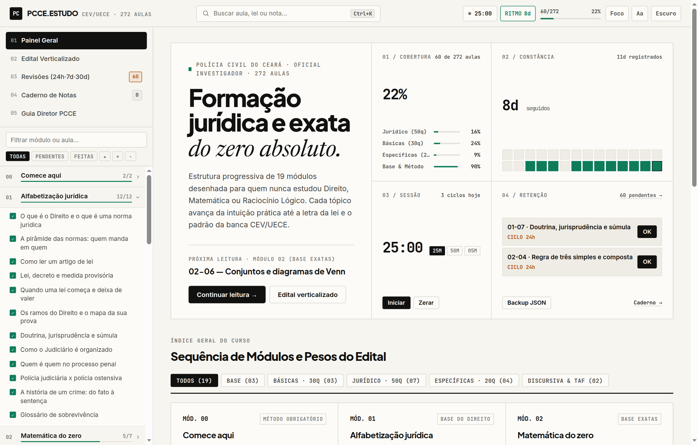
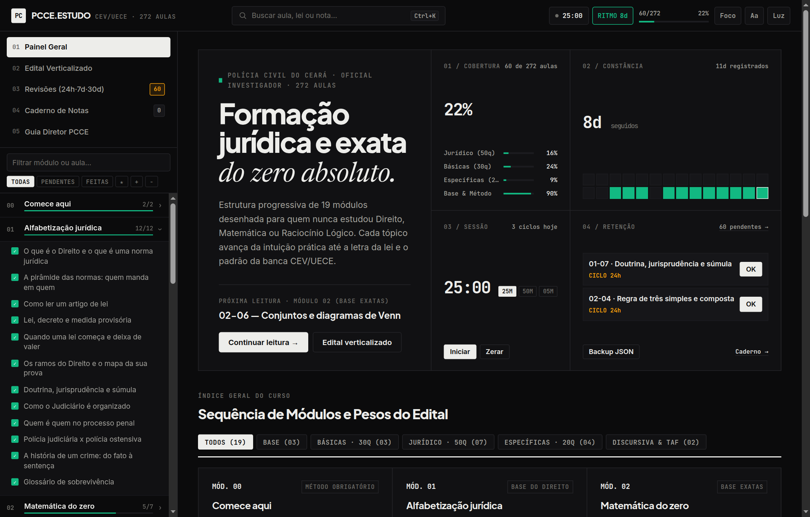
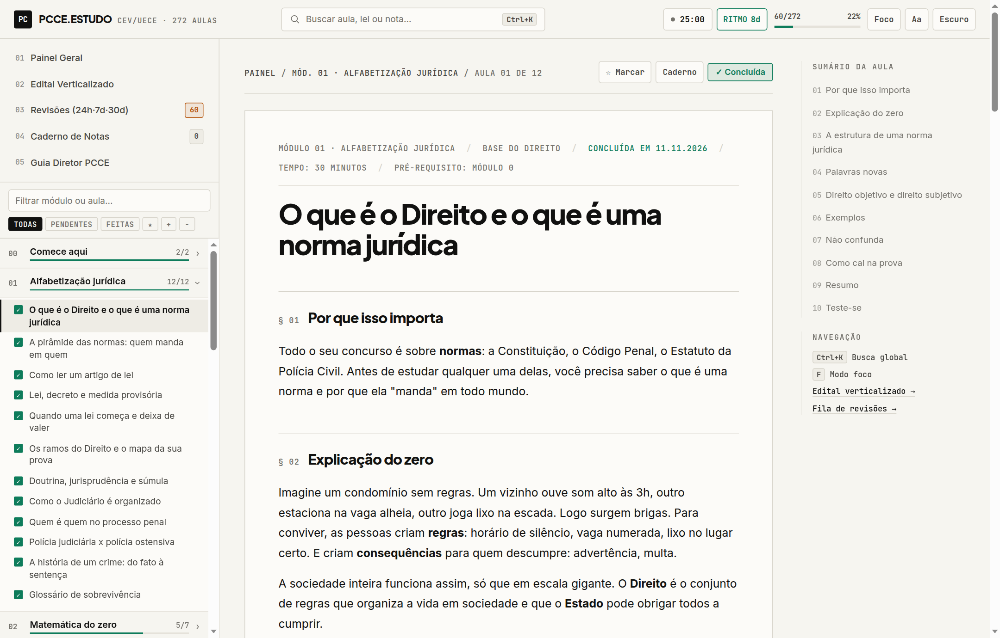
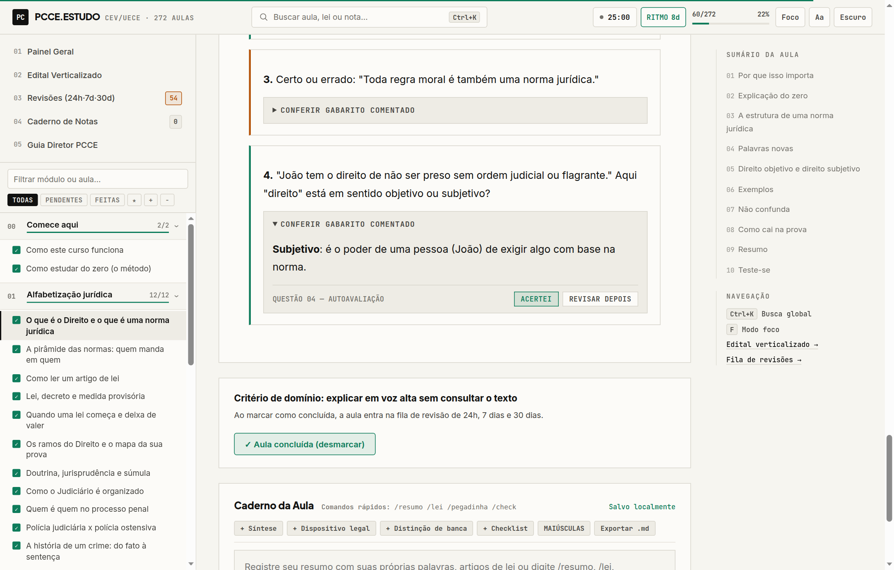
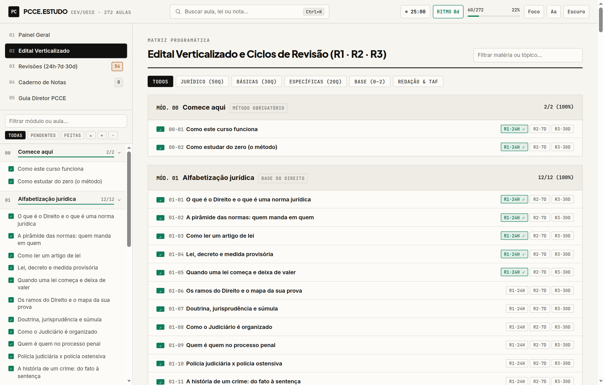
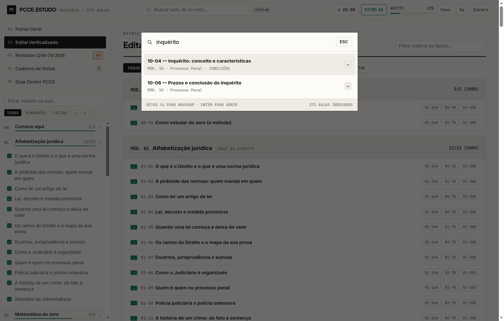
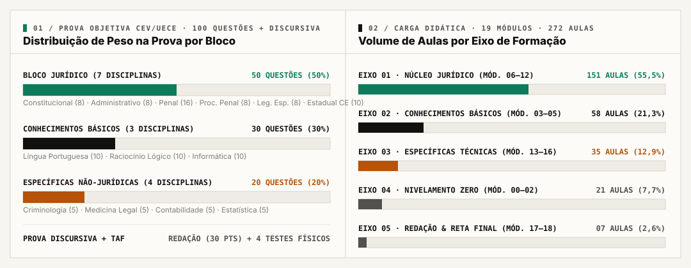
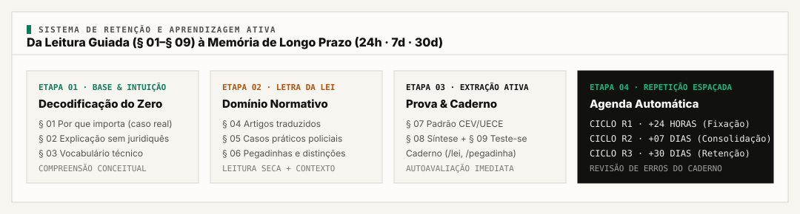
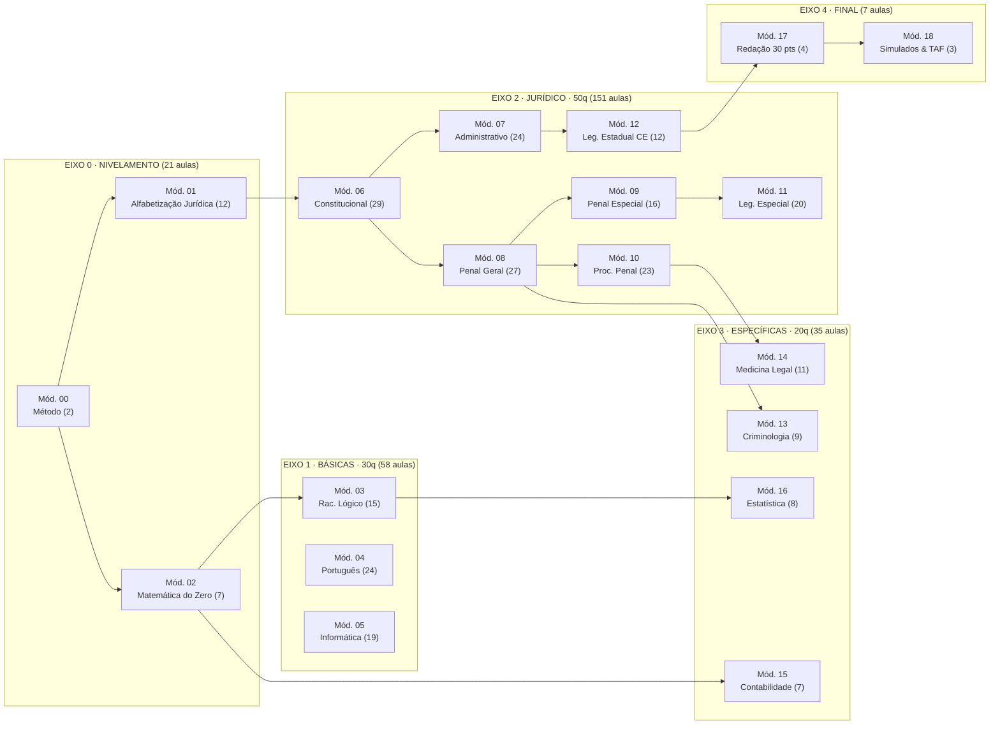
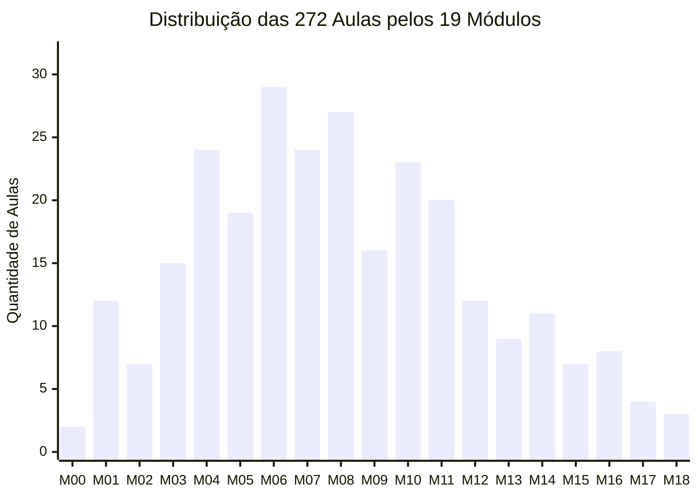

# PCCE.ESTUDO — Plano de Estudos e Formação do Zero Absoluto

> Plataforma aberta de formação jurídica, exata e técnica para o concurso de **Oficial Investigador da Polícia Civil do Ceará (PCCE · Banca CEV/UECE)** — estruturada em **19 módulos** e **272 aulas** escritas do zero absoluto, sem pré-requisitos.

**Aplicação online:** [https://adriwco.github.io/police.study.plan.ce/](https://adriwco.github.io/police.study.plan.ce/) · **Plano Diretor:** [GUIA-COMPLETO-PCCE.md](GUIA-COMPLETO-PCCE.md)

| Eixo | Escopo | Métrica |
| :--- | :--- | :--- |
| **Cobertura Curricular** | Nivelamento, Básicas, Jurídico, Específicas, Redação e TAF | **19 módulos · 272 aulas** |
| **Prova Objetiva (CEV/UECE)** | Jurídico (50q) · Básicas (30q) · Específicas (20q) | **100 questões** |
| **Prova Discursiva** | Redação oficial / dissertação sobre segurança pública e Direito | **30 pontos** |
| **Sistema de Retenção** | Revisão espaçada automática pós-conclusão | **R1 (24h) · R2 (7d) · R3 (30d)** |
| **Arquitetura de Interface** | Grade Suíça (`1px`), tríade tipográfica editorial e zero dependências de servidor | **WCAG AA · Offline-First** |

---

## Interface e Sistema Editorial

A interface foi desenhada sobre princípios de **Grade Arquitetural Suíça** e leitura técnica de longa duração (inspirada em sistemas como *Readwise Reader*, *Linear*, *Craft* e *LeapNotes*), eliminando distrações visuais e priorizando contraste tipográfico, hierarquia normativa e velocidade por teclado.

### 01 · Painel Geral — Temas Papel Editorial (`Light`) e Carbono Obsidiana (`Dark`)

| Tema Papel Editorial (`#F6F5F0` / `#111110`) | Tema Carbono Obsidiana (`#0B0B0C` / `#EDEDEA`) |
| :---: | :---: |
|  |  |
| *Grade Suíça com métricas de cobertura por bloco, matriz de constância de 28 dias, cronômetro de sessão e fila de retenção.* | *Modo noturno de carbono neutro sem brilho artificial, calibrado para sessões noturnas prolongadas.* |

### 02 · Leitura Normativa (`§ 01..§ 10`), Autoavaliação e Caderno de Estudos

| Leitura Guiada e Sumário Lateral Fixo | Questões Comentadas e Caderno com Comandos `/` |
| :---: | :---: |
|  |  |
| *Seções numeradas (`§ 01`), transcrição de lei em serifada editorial (`Newsreader`) e sumário sincronizado via `IntersectionObserver`.* | *Autoavaliação por questão (`Acertei` / `Revisar depois`) integrada à fila de revisão e bloco de notas com atalhos `/lei`, `/resumo` e `/pegadinha`.* |

### 03 · Matriz do Edital Verticalizado e Busca Global (`Ctrl+K`)

| Edital Verticalizado com Ciclos `R1 · R2 · R3` | Paleta de Comandos e Busca Instantânea (`Ctrl+K`) |
| :---: | :---: |
|  |  |
| *Controle individual das 272 aulas e dos 3 ciclos de repetição espaçada (`24h`, `7d`, `30d`) filtrado por bloco da prova.* | *Pesquisa em tempo real sobre títulos de aulas, módulos, anotações pessoais do caderno e ações rápidas.* |

---

## Arquitetura do Edital e Distribuição de Carga



### Fluxo de Aprendizagem Ativa e Retenção Espaçada



### Encadeamento Pedagógico dos Módulos (Ordem de Dependência)



### Densidade de Aulas por Módulo (`00` a `18` · Total: 272 Aulas)



---

## Matriz Curricular Completa

Cada uma das **272 aulas** segue rigorosamente uma estrutura em **9 seções padronizadas**:
1. **Por que isso importa** — situação concreta da atividade policial.
2. **Explicação do zero** — conceito construído sem jargão prévio.
3. **Palavras novas** — glossário técnico da aula.
4. **O que diz a lei** — dispositivo normativo transcrito e traduzido linha por linha.
5. **Exemplos** — aplicação em casos reais.
6. **Não confunda** — quadro comparativo entre institutos próximos.
7. **Como cai na prova** — padrão de cobrança da banca CEV/UECE.
8. **Resumo** — síntese enxuta para revisão rápida.
9. **Teste-se** — questões inéditas e de concurso com gabarito comentado e autoavaliação.

| Mód. | Disciplina | Bloco do Edital | Aulas | Peso na Prova |
| :---: | :--- | :--- | :---: | :--- |
| `00` | Comece aqui: método e funcionamento | Nivelamento & Base | 02 | Método obrigatório |
| `01` | Alfabetização Jurídica | Nivelamento & Base | 12 | Base do Direito |
| `02` | Matemática do Zero | Nivelamento & Base | 07 | Base de Exatas |
| `03` | Raciocínio Lógico | Conhecimentos Básicos | 15 | 10 questões (10%) |
| `04` | Língua Portuguesa | Conhecimentos Básicos | 24 | 10 questões (10%) |
| `05` | Informática | Conhecimentos Básicos | 19 | 10 questões (10%) |
| `06` | Direito Constitucional | Bloco Jurídico | 29 | 08 questões (8%) |
| `07` | Direito Administrativo | Bloco Jurídico | 24 | 08 questões (8%) |
| `08` | Direito Penal — Parte Geral | Bloco Jurídico | 27 | 08 questões (8%) |
| `09` | Direito Penal — Parte Especial | Bloco Jurídico | 16 | 08 questões (8%) |
| `10` | Direito Processual Penal | Bloco Jurídico | 23 | 08 questões (8%) |
| `11` | Legislação Penal e Processual Especial | Bloco Jurídico | 20 | 08 questões (8%) |
| `12` | Legislação Estadual (Estatuto PCCE e CE) | Bloco Jurídico | 12 | **10 questões (10% · Maior peso)** |
| `13` | Criminologia | Específicas Técnicas | 09 | 05 questões (5%) |
| `14` | Medicina Legal | Específicas Técnicas | 11 | 05 questões (5%) |
| `15` | Contabilidade Geral | Específicas Técnicas | 07 | 05 questões (5%) |
| `16` | Estatística | Específicas Técnicas | 08 | 05 questões (5%) |
| `17` | Redação Discursiva | Prova Discursiva | 04 | **30 pontos** |
| `18` | Reta Final, Simulados e TAF | Preparação Final | 03 | Simulados + 4 testes físicos |
| **Total** | **19 Módulos** | **5 Eixos** | **272** | **100 questões + 30 pts + TAF** |

---

## Engenharia Front-End e Pilares Técnicos

- **Tipografia Tripartida:**
  - `Newsreader` (serifada editorial para subtítulos em itálico e dispositivos de lei seca em `blockquote`).
  - `Plus Jakarta Sans` + `Inter` (estrutura Neo-Grotesca com largura de linha travada em `66ch` para conforto ocular).
  - `JetBrains Mono` (`tabular-nums` para contadores, cronômetro, índices `§ 01` e códigos de módulo).
- **Acessibilidade (`a11y`):**
  - Landmarks semânticos (`header`, `nav`, `main`, `aside`, `article`), link de salto rápido (*Pular para o conteúdo principal*), atributos `aria-live`, `aria-expanded`, `aria-current="page"` e `aria-pressed`.
  - Navegação integral por teclado: `Ctrl+K` ou `/` (busca global), `F` (modo foco), `[` e `]` (aula anterior/próxima), `Esc` (fechar modais).
  - Suporte a `prefers-reduced-motion: reduce`, 4 escalas de fonte (`Aa`) e estilo dedicado de impressão (`@media print`).
- **Performance e Resiliência:**
  - Cache em memória das aulas renderizadas e *prefetch* automático da próxima aula em segundo plano via `requestIdleCallback`.
  - Persistência 100% local (`localStorage`) retrocompatível (`pcce.feitas`, `pcce.abertos`, `pcce.tema`, `pcce.nota.<id>`, `pcce.dias`, `pcce.revisoes`, `pcce.questoes`, `pcce.favoritos`) com exportação e restauração em `.json` e `.md`.
- **Segurança Web:**
  - Política de Segurança de Conteúdo (`Content-Security-Policy`) declarada e sanitização de DOM pós-renderização Markdown contra injeção de scripts ou atributos `on*`.

---

## Estrutura de Diretórios

```text
.
├── index.html                  aplicação principal (SPA acessível, SEO + JSON-LD)
├── manifest.webmanifest        manifesto Web App (PWA)
├── GUIA-COMPLETO-PCCE.md       plano diretor completo (edital, ciclos, TAF e bibliografia)
├── assets/
│   ├── styles.css              sistema de design Swiss Editorial, temas e responsividade
│   ├── app.js                  motor de rotas, estado local, busca Ctrl+K, revisões e caderno
│   └── favicon.svg             emblema vetorial da plataforma
├── aulas/
│   ├── trilha.json             índice estruturado dos 19 módulos e 272 aulas
│   └── 00-comece-aqui/ ... 18  272 arquivos Markdown (.md) organizados por módulo
├── docs/
│   ├── charts/                 infográficos vetoriais (.svg) da matriz do edital e retenção
│   └── screenshots/            capturas de tela em alta definição da interface
└── scripts/
    └── atualizar_trilha.py     utilitário para regenerar aulas/trilha.json ao criar novas aulas
```

## Como Executar Localmente

Como os arquivos `.md` e `aulas/trilha.json` são carregados via `fetch`, sirva o diretório com um servidor HTTP estático:

```bash
python3 -m http.server 8000
```

Acesse `http://localhost:8000` no navegador.

Para adicionar uma nova aula, crie o arquivo `.md` dentro da pasta do respectivo módulo em `aulas/<modulo>/` e atualize o índice:

```bash
python3 scripts/atualizar_trilha.py
```

---

## Aviso Legal

Material didático independente e gratuito voltado à preparação de candidatos. Consulte sempre a legislação atualizada no Portal do Planalto/ALECE e o edital oficial vigente publicado pela PCCE e pela banca organizadora.
